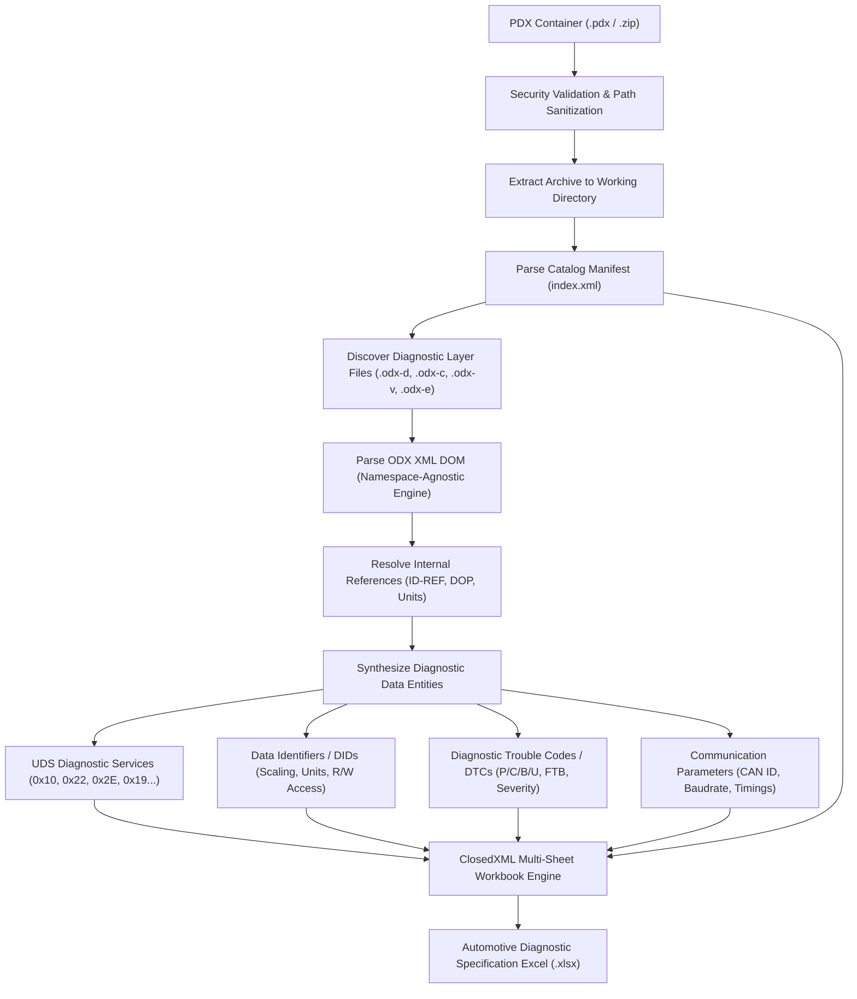

# Technical Specification & Approach: Unzipping PDX & Extracting Diagnostic Data from Packaged ODX Files

## 1. Executive Summary & Automotive Standards

In modern automotive engineering, diagnostic data exchange between OEMs, Tier-1 suppliers, and engineering toolchains is standardized under the **ASAM MCD-2 D** and **ISO 22901** series:
* **ISO 22901-1 (ODX - Open Diagnostic Data Exchange)**: Defines the XML data model for ECU diagnostic descriptions (services, requests, responses, parameters, scaling, and fault codes).
* **ISO 22901-2 (PDX - Packaged Diagnostic Exchange)**: Specifies the packaging format for distributing collections of related ODX files, catalog metadata, companion specifications, and vehicle topologies inside a single container.

This document details the engineering methodology implemented in the **`OdxDiagnosticParser`** solution to safely unpack PDX containers, traverse the manifest catalog, parse ODX XML layers, resolve semantic diagnostic models (UDS/KWP), and export the resulting data to professional, multi-worksheet Excel spreadsheets.

---

## 2. Architecture & Processing Pipeline

The following flowchart illustrates the end-to-end pipeline from a compressed PDX archive to an engineering Excel workbook:



---

## 3. PDX Container Format & Safe Unzipping Methodology

### 3.1 Anatomical Structure of a PDX Package

A `.pdx` file is structurally a standard PKZIP archive. Its internal layout typically conforms to the following directory hierarchy:

```
Vehicle_EMS.pdx
├── index.xml                         <-- Catalog Manifest (MCD-2 D specification)
├── odx-d/                            <-- Diagnostic Layer Files
│   ├── EngineControlUnit.odx-d       <-- ECU Variant / Base Variant specifications
│   └── TransmissionControl.odx-d
├── odx-c/                            <-- Communication Protocol Layer
│   └── Protocols_UDS_CAN.odx-c       <-- ISO 14229 / ISO 15765-2 Bus Parameters
├── odx-v/                            <-- Vehicle Topology / Architecture
│   └── VehicleTopology.odx-v
└── odx-e/                            <-- ECU Shared Data / Coding Parameters
    └── SharedDopsAndCompu.odx-e
```

### 3.2 Security Hardening: Zip-Slip Vulnerability Prevention

Extracting archives containing unvetted third-party data poses severe security hazards if file paths within the ZIP contain directory traversal sequences (`../` or `..\`). If extracted naively using `ZipFile.ExtractToDirectory`, files could overwrite critical operating system or application binaries.

#### Implementation in `PdxPackageExtractor.cs`:
To guarantee safety, every entry is validated against the canonicalized target root before extraction:

```csharp
var canonicalDestDir = Path.GetFullPath(destDir);
if (!canonicalDestDir.EndsWith(Path.DirectorySeparatorChar.ToString(), StringComparison.Ordinal))
    canonicalDestDir += Path.DirectorySeparatorChar;

using var archive = ZipFile.OpenRead(pdxFilePath);
foreach (var entry in archive.Entries)
{
    var destinationPath = Path.GetFullPath(Path.Combine(canonicalDestDir, entry.FullName));

    // Enforce path containment
    if (!destinationPath.StartsWith(canonicalDestDir, StringComparison.OrdinalIgnoreCase))
    {
        throw new SecurityException($"Malicious zip entry detected attempting path traversal: {entry.FullName}");
    }

    var parentDir = Path.GetDirectoryName(destinationPath);
    if (!string.IsNullOrEmpty(parentDir) && !Directory.Exists(parentDir))
    {
        Directory.CreateDirectory(parentDir);
    }

    entry.ExtractToFile(destinationPath, overwrite: true);
}
```

---

## 4. Catalog Manifest Parsing (`index.xml`)

The `index.xml` catalog file acts as the table of contents for the entire diagnostic package. It defines:
1. **Catalog Metadata**: Authoring company, creation timestamp, schema model version (ODX 2.0.1 or 2.2.0).
2. **Vehicle Definitions (`<VEHICLES>` / `<VEHICLE-INFO>`)**: Vehicle models, brands, model years.
3. **ECU Definitions (`<ECUS>` / `<ECU-INFO>`)**: ECU names, suppliers, diagnostic physical/functional addresses.
4. **Packaged Elements (`<CATALOG-ELEMENTS>` / `<CATALOG-ELEMENT>`)**: Relative file paths, file types (`ODX-D`, `ODX-C`, `ODX-V`, etc.), file sizes, and MD5/SHA1 checksums for integrity verification.

```xml
<CATALOG MODEL-VERSION="2.2.0">
  <SHORT-NAME>PACK_Powertrain_EMS_V1</SHORT-NAME>
  <CREATOR>BlueBinaries Diagnostic Authoring Suite</CREATOR>
  <DATE>2026-11-03</DATE>
  <VEHICLES>
    <VEHICLE-INFO>
      <MODEL>BlueBinaries GT-2026</MODEL>
      <COMPANY>BlueBinaries Engineering</COMPANY>
    </VEHICLE-INFO>
  </VEHICLES>
  <CATALOG-ELEMENTS>
    <CATALOG-ELEMENT TYPE="ODX-D">
      <SHORT-NAME>EngineControlUnit_DiagnosticLayer</SHORT-NAME>
      <FILE-PATH>odx-d/EngineControlUnit.odx-d</FILE-PATH>
      <CHECKSUM>c4ca4238a0b923820dcc509a6f75849b</CHECKSUM>
    </CATALOG-ELEMENT>
  </CATALOG-ELEMENTS>
</CATALOG>
```

---

## 5. ODX XML Parsing Strategy & Dependency Resolution

### 5.1 Namespace-Agnostic XML Traverser

In industry practice, ODX files vary widely in their XML namespace declarations:
* Some suppliers include `xmlns="http://iso.org/iso22901"`.
* Others declare `xmlns="http://asam.net/mcd-2d/odx"`.
* Legacy or internal authoring tools omit namespaces entirely.

To prevent silent query failures, `OdxXmlParser` uses a **namespace-agnostic extension layer** (`OdxXmlExtensions.cs`). Element lookups match on `XName.LocalName` using ordinal case-insensitivity, ensuring 100% interoperability across all ODX versions:

```csharp
public static XElement? El(this XContainer? container, string localName) =>
    container?.Elements().FirstOrDefault(e =>
        string.Equals(e.Name.LocalName, localName, StringComparison.OrdinalIgnoreCase));
```

### 5.2 Extracting Diagnostic Services (ISO 14229 / UDS)

Each `<DIAG-SERVICE>` node is parsed to extract:
* **Service Identification (SID)**:
  - Extracted from `<REQUEST>` -> `<PARAMS>` -> `<PARAM SEMANTIC="SERVICE-ID">` (e.g., `0x10`, `0x22`, `0x2E`, `0x19`, `0x14`, `0x27`).
  - If omitted in constant parameters, automatically inferred from service naming patterns.
* **Sub-Function**:
  - Found under `<PARAM SEMANTIC="SUBFUNCTION">` or byte offset 1 for sub-function capable services (0x10, 0x19, 0x27, 0x31, 0x85).
* **Positive Response**:
  - Standard UDS positive response SID: $\text{ReqSID} + 0\text{x}40$ (e.g. `0x10` $\rightarrow$ `0x50`, `0x22` $\rightarrow$ `0x62`, `0x2E` $\rightarrow$ `0x6E`).
* **Negative Response Codes (NRCs)**:
  - Extracted from `<NEG-RESPONSE-REF>` links and mapped to UDS NRC standard descriptions (e.g., `0x12 SubFunctionNotSupported`, `0x31 RequestOutOfRange`, `0x33 SecurityAccessDenied`, `0x78 ResponsePending`).

### 5.3 Extracting Data Identifiers (DIDs) & Physical Scaling

DIDs represent sensor parameters, configuration flags, calibration constants, and ECU serial numbers accessed via UDS Service `0x22` (ReadDataByIdentifier) and `0x2E` (WriteDataByIdentifier).

The parser extracts DIDs through the following multi-stage resolution:
1. **DID Identification**: Read from the 2-byte parameter (`SEMANTIC="DATA-ID"`) in the request message (e.g. `0xF190` - VIN, `0x0105` - Engine Coolant Temperature).
2. **Access Rights Resolution**:
   - If the DID appears in a `0x22` service: marked as **Read**.
   - If it appears in a `0x2E` service: marked as **Write**.
   - If present in both services: merged and marked as **Read/Write**.
3. **DOP (Data Object Property) Resolution**:
   - The response payload parameter references a `<DOP-REF ID-REF="...">`.
   - The parser resolves the DOP to retrieve the base data type (`A_UINT32`, `A_ASCIISTRING`, `A_FLOAT32`), bit length, physical unit (`rpm`, `degC`, `km/h`, `V`), and linear scaling coefficients.

#### Linear Scaling Formula:
For linear computation methods:
$$\text{Physical Value} = (\text{Internal Coded Value} \times \text{Factor}) + \text{Offset}$$

*Example: Engine Coolant Temp (DID 0x0105)*
- Factor = `1.0`, Offset = `-40.0`, Unit = `degC`
- Hex raw value `0x50` (80 decimal) $\rightarrow (80 \times 1.0) - 40.0 = 40^\circ\text{C}$.

*Example: Engine Speed (DID 0x010C)*
- Factor = `0.25`, Offset = `0.0`, Unit = `rpm`
- Hex raw value `0x1F40` (8000 decimal) $\rightarrow 8000 \times 0.25 = 2000\text{ rpm}$.

### 5.4 Extracting Diagnostic Trouble Codes (DTCs)

In modern automotive systems, DTCs follow the **SAE J2012-DA** and **ISO 14229-1** 3-byte format:
* **Byte 2 & 1**: 2-byte Core Fault Identifier.
* **Byte 0**: 1-byte Failure Type Byte (FTB) defining the electrical/logical symptom (e.g., `0x13` = Circuit Open, `0x17` = Voltage Above Threshold, `0x92` = Misfire Detected).

#### Alphanumeric Display Code Derivation:
The parser decodes the top two bits of Byte 2 into the standard automotive functional system letter:
* `00` $\rightarrow$ **P** (Powertrain: Engine, Transmission, Hybrid)
* `01` $\rightarrow$ **C** (Chassis: ABS, ESP, Steering, Suspension)
* `10` $\rightarrow$ **B** (Body: Airbags, Climate, Lighting, Doors)
* `11` $\rightarrow$ **U** (Network & Communication: CAN, LIN, Ethernet, Gateway)

*Example Decoding:*
$$\text{Trouble Code } 65555 = 0\text{x}010013$$
- High Byte = `0x01` $\rightarrow$ Bits 7-6 = `00` $\rightarrow$ **P**
- Fault Code = `P0100`
- FTB = `0x13` (Circuit Open)
- Formatted UDS Code = **`P0100-13`**

---

## 6. Excel Workbook Generation Design (`ClosedXML`)

The `OdxExcelExporter` synthesizes the parsed diagnostic models into an engineering-grade Excel (.xlsx) file structured across multiple dedicated worksheets:

| Worksheet Tab | Content & Columns | Purpose |
| :--- | :--- | :--- |
| **Overview** | Package Metadata, ODX Version, Timestamp, Vehicle & ECU Summaries, Metrics KPI Card | Executive dashboard and document control |
| **Diagnostic Services** | ECU Name, Service ID (Hex), Service Name, Semantic, Sub-Function, Response SID, Parameters, NRCs, Description | Complete UDS/KWP service implementation catalog |
| **Data Identifiers (DIDs)** | ECU Name, DID (Hex), DID (Dec), Name, Access (Read/Write color-coded), Length (Bytes/Bits), Data Type, Unit, Scaling Factor, Offset, Min/Max Limits, Description | Comprehensive DID engineering specification |
| **DTCs (Trouble Codes)** | ECU Name, Display Code (e.g. P0100-13), Trouble Code Hex, Trouble Code Dec, FTB, Severity (Fatal/Warning), Description | Diagnostic Trouble Code fault matrix |
| **Communication Parameters** | ECU Name, Parameter Name (e.g. CP_CanId, CP_Baudrate), Value, Unit, Protocol, Description | Bus addressing and timing parameters |
| **PDX Manifest** | File Name, File Type (ODX-D/ODX-C), Relative Path, File Size, MD5 Checksum | Packaging verification and artifact traceability |

### 6.1 Visual Styling Specifications
* **Header Fill**: Dark Navy `#1B365D` with bold white lettering.
* **Zebra Striping**: Alternating row background `#F8FAFC` to maximize scanning comfort.
* **Status Badges**: Read-only DIDs rendered in Green (`#27AE60`); Read/Write or Write DIDs rendered in Dark Red (`#C0392B`).
* **Usability Enhancements**:
  - Top rows frozen across all sheets (`FreezeRows(1)`) so table column headings stay fixed during scrolling.
  - Native Excel auto-filter enabled on all data ranges.
  - Column AutoFit bounded by a maximum width guard (55 characters) to prevent wide description fields from degrading readability.

---

## 7. Developer Integration Guide

### 7.1 Converting a Single ODX File to Excel
```csharp
using OdxDiagnosticParser.Exporters;
using OdxDiagnosticParser.Parsers;

var parser = new OdxXmlParser();
var exporter = new OdxExcelExporter();

// 1. Parse ODX XML
var package = parser.ParseFile("EngineControlUnit.odx-d");

// 2. Export to Excel
exporter.ExportToExcel(package, "EngineDiagnostics.xlsx");
```

### 7.2 Unpacking and Converting a PDX Archive to Excel
```csharp
using OdxDiagnosticParser.Exporters;
using OdxDiagnosticParser.Parsers;

var extractor = new PdxPackageExtractor();
var exporter = new OdxExcelExporter();

// 1. Extract PDX and aggregate all packaged ODX layers
var package = extractor.ExtractAndParse("Vehicle_EMS.pdx");

// 2. Export consolidated workbook
exporter.ExportToExcel(package, "Vehicle_EMS_Diagnostics.xlsx");
```

---

## 8. Summary of Benefits

* **Zero COM / MS Office Dependencies**: Powered by `ClosedXML` and `DocumentFormat.OpenXml`, running cleanly on Windows, Linux, and macOS servers or CI/CD build agents.
* **Robust Multi-Version Compatibility**: Handles ODX 2.0.1, ODX 2.2.0, and ISO 22901-1 files regardless of XML namespace variations.
* **Security First**: Built-in Zip Slip protection defends against malicious archive path traversal attacks.
* **Full Semantic Diagnostics**: Automatically computes UDS service IDs, response offsets, DTC fault codes (P/C/B/U), and DID physical engineering units/scaling.

